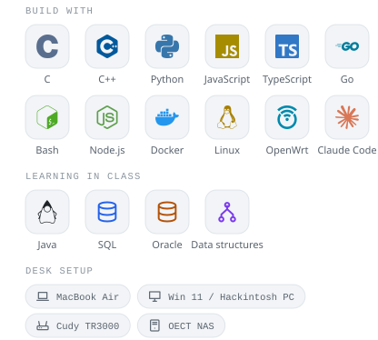

  <picture>
    <source media="(prefers-color-scheme: dark)" srcset="assets/profile/header-dark.svg">
    <source media="(prefers-color-scheme: light)" srcset="assets/profile/header-light.svg">
    
  </picture>
  

    
    
    
    
  

### About me

<picture>
  <source media="(prefers-color-scheme: dark)" srcset="assets/profile/techstack-dark.svg">
  <source media="(prefers-color-scheme: light)" srcset="assets/profile/techstack-light.svg">
  
</picture>

I'm a Software Engineering undergraduate at **Northwest A&F University (NWAFU)**. I like taking an idea through whatever stack it needs, whether that's a Flutter app, a Go network client or an OpenWrt package, until it actually runs and other people can use it.

**What I'm into right now**

- 🌱 **Open source:** campus tools and practical software
- 🤖 **LLMs & agents:** Claude Code, Skills and automating my dev workflow
- 📚 **Computer science:** data structures, databases, Java
- 🛠️ **Systems & networking:** Linux, networks, operating systems, hardware

 

### GitHub stats

  <picture>
    <source media="(prefers-color-scheme: dark)" srcset="assets/stats/stats-dark.svg">
    <source media="(prefers-color-scheme: light)" srcset="assets/stats/stats-light.svg">
    
  </picture>
  <picture>
    <source media="(prefers-color-scheme: dark)" srcset="assets/stats/languages-dark.svg">
    <source media="(prefers-color-scheme: light)" srcset="assets/stats/languages-light.svg">
    
  </picture>
  <picture>
    <source media="(prefers-color-scheme: dark)" srcset="assets/stats/streak-dark.svg">
    <source media="(prefers-color-scheme: light)" srcset="assets/stats/streak-light.svg">
    
  </picture>
  <picture>
    <source media="(prefers-color-scheme: dark)" srcset="assets/stats/activity-dark.svg">
    <source media="(prefers-color-scheme: light)" srcset="assets/stats/activity-light.svg">
    
  </picture>

