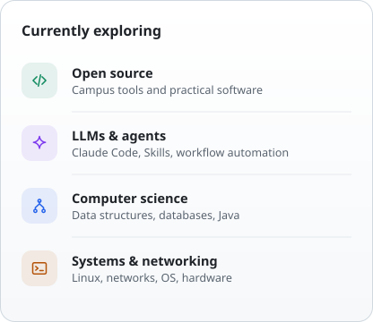
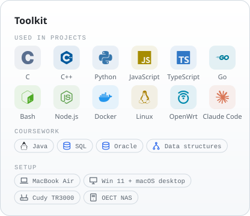
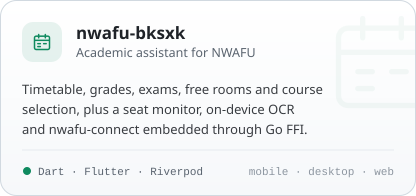
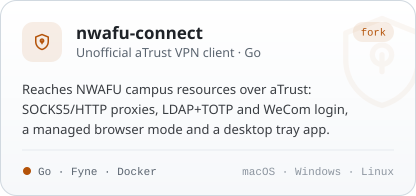
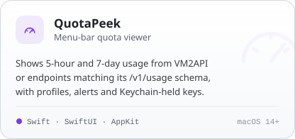
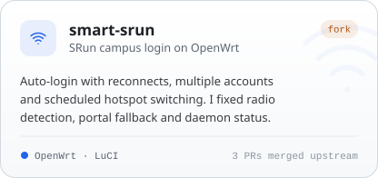

<picture>
  <source media="(prefers-color-scheme: dark)" srcset="assets/profile/hero-dark.svg">
  <source media="(prefers-color-scheme: light)" srcset="assets/profile/hero-light.svg">
  
</picture>

  <b>Software Engineering Undergraduate @ Northwest A&amp;F University</b> 
  I like taking an idea through whatever stack it needs, from a Flutter app to a Go network client or an OpenWrt package, until it actually runs.

  
  

  <picture>
    <source media="(prefers-color-scheme: dark)" srcset="assets/profile/focus-dark.svg">
    <source media="(prefers-color-scheme: light)" srcset="assets/profile/focus-light.svg">
    
  </picture>
  <picture>
    <source media="(prefers-color-scheme: dark)" srcset="assets/profile/toolkit-dark.svg">
    <source media="(prefers-color-scheme: light)" srcset="assets/profile/toolkit-light.svg">
    
  </picture>

### Selected projects

  <a href="https://github.com/majianyu2007/nwafu-bksxk"><picture>
    <source media="(prefers-color-scheme: dark)" srcset="assets/profile/project-nwafu-bksxk-dark.svg">
    <source media="(prefers-color-scheme: light)" srcset="assets/profile/project-nwafu-bksxk-light.svg">
    
  </picture></a>
  <a href="https://github.com/majianyu2007/nwafu-connect"><picture>
    <source media="(prefers-color-scheme: dark)" srcset="assets/profile/project-nwafu-connect-dark.svg">
    <source media="(prefers-color-scheme: light)" srcset="assets/profile/project-nwafu-connect-light.svg">
    
  </picture></a>
  <a href="https://github.com/majianyu2007/QuotaPeek"><picture>
    <source media="(prefers-color-scheme: dark)" srcset="assets/profile/project-quotapeek-dark.svg">
    <source media="(prefers-color-scheme: light)" srcset="assets/profile/project-quotapeek-light.svg">
    
  </picture></a>
  <a href="https://github.com/majianyu2007/smart-srun"><picture>
    <source media="(prefers-color-scheme: dark)" srcset="assets/profile/project-smart-srun-dark.svg">
    <source media="(prefers-color-scheme: light)" srcset="assets/profile/project-smart-srun-light.svg">
    
  </picture></a>

  nwafu-connect is adapted from <a href="https://github.com/Mythologyli/zju-connect">Mythologyli/zju-connect</a>.
  smart-srun is a fork of <a href="https://github.com/matthewlu070111/smart-srun">matthewlu070111/smart-srun</a>; my fixes landed upstream in
  <a href="https://github.com/matthewlu070111/smart-srun/pulls?q=is%3Apr+author%3Amajianyu2007">#33–#35</a>.

### GitHub activity

  <picture>
    <source media="(prefers-color-scheme: dark)" srcset="assets/stats/overview-dark.svg">
    <source media="(prefers-color-scheme: light)" srcset="assets/stats/overview-light.svg">
    
  </picture>
  <picture>
    <source media="(prefers-color-scheme: dark)" srcset="assets/stats/activity-dark.svg">
    <source media="(prefers-color-scheme: light)" srcset="assets/stats/activity-light.svg">
    
  </picture>

  Rendered daily by a <a href="https://github.com/majianyu2007/majianyu2007/actions/workflows/update-stats.yml">GitHub Action</a> from public GitHub data and committed as static SVGs.
  Repository, star and language counts exclude forks; languages are counted per repository, not by code volume. Streaks cover the displayed calendar, not lifetime records.

<a href="assets/stats/github-stats.json">Data snapshot</a> · <a href="docs/profile-maintenance.md">Maintenance</a>

